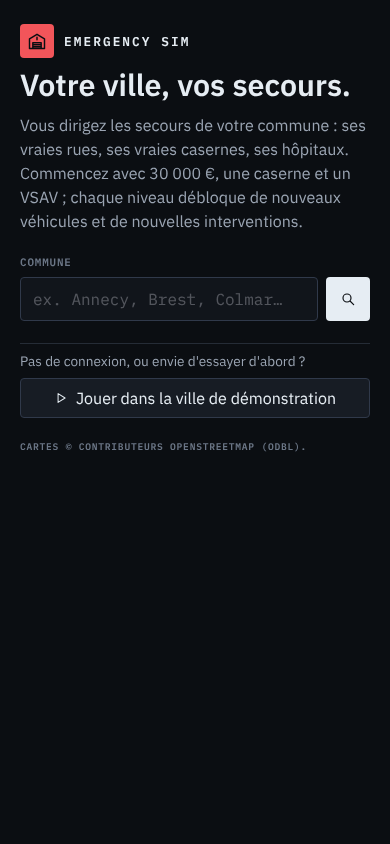
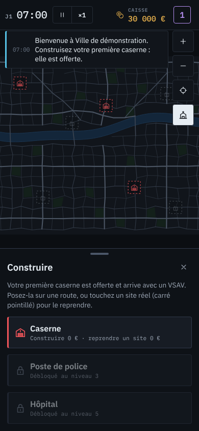
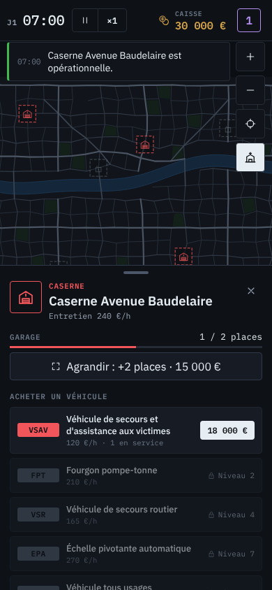
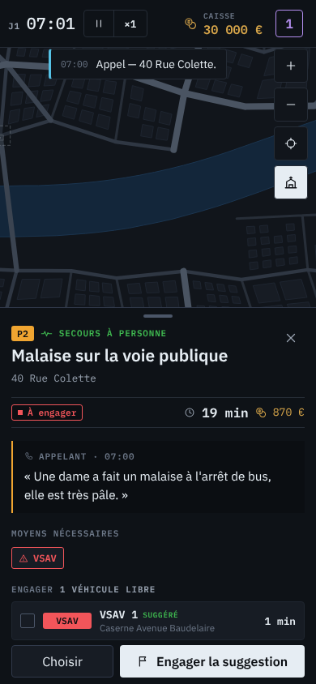
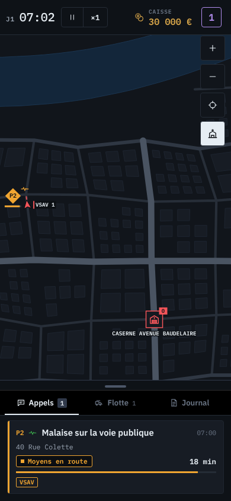
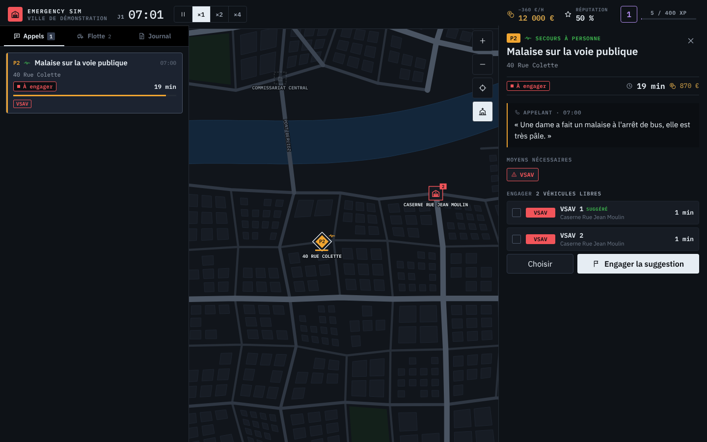

# Emergency Sim

Dirigez les secours de **votre** commune : ses vraies rues, ses vraies casernes et ses hôpitaux, tirés d'OpenStreetMap.

Le jeu se déroule en mode carrière, sauvegardé en continu :
- vous démarrez avec 30 000 €, une caserne et un VSAV ;
- chaque intervention réussie rapporte de l'argent et de l'expérience ;
- **12 niveaux** débloquent bâtiments, véhicules et interventions.

Construit avec [Exact](https://github.com/expo/exact) : une seule source pour le web, iOS, macOS, Android et Linux.

| Votre ville | Construire | Caserne et garage | Fiche d'appel | En route |
|---|---|---|---|---|
|  |  |  |  |  |



## Le jeu

**Votre ville**
- Tapez le nom de votre commune : rues, bâtiments, cours d'eau et bases réelles sont téléchargés depuis OpenStreetMap (Overpass), puis sauvegardés.
- Une ville de démonstration permet de jouer hors ligne.

**Construire**
- Posez un bâtiment n'importe où sur une route, ou **reprenez un site réel** (carré pointillé sur la carte), moins cher.
- Trois bâtiments : caserne, poste de police, hôpital.
- Chaque garage s'agrandit de 2 places à chaque extension.
- Une victime amenée dans **votre** hôpital rapporte 600 €.

**Économie**
- Primes selon l'urgence et la rapidité d'arrivée, modulées par la **réputation**.
- **Entretien horaire** de chaque véhicule et de chaque bâtiment.
- Un véhicule libre peut être revendu à moitié prix.

**Progression** : 12 niveaux. Un type d'intervention n'arrive qu'une fois que vous possédez **tous** les véhicules qu'il demande : c'est l'achat qui ouvre les nouvelles missions.

| Niv. | Débloque | Exemples d'interventions |
|---|---|---|
| 1 | Caserne, VSAV | malaise, chute de personne âgée, blessé léger |
| 2 | FPT | feux de poubelles, de véhicule, de végétation, alarme incendie |
| 3 | Poste de police, Police-secours | tapage, différend familial, cambriolage, animal errant |
| 4 | VSR | accident de la route, accident de deux-roues |
| 5 | Hôpital, ambulance | transport urgent, intoxication au CO, accident de travail |
| 6 | SMUR | arrêt cardiaque, détresse respiratoire, AVC |
| 7 | EPA | feu d'appartement, personne bloquée en hauteur |
| 8 | BAC | vol à l'arraché, rixe, braquage |
| 9 | VTU | inondation, fuite de gaz, frelons, ascenseur bloqué |
| 10 | FPTGP | feu d'entrepôt, feu industriel |
| 11 | Hélicoptère SAMU (vole en ligne droite) | noyade, accident grave isolé |
| 12 | VPMA | accident de car, plan rouge |

En tout : **34 types d'interventions** et **12 véhicules**.

**Régulation**
- Pour chaque appel, l'appelant décrit la situation et vous qualifiez l'appel parmi 5 familles. Une erreur coûte de la réputation.
- Le jeu suggère les véhicules les plus proches ; vous pouvez modifier la sélection.
- Les itinéraires empruntent les vraies rues, avec la circulation des heures de pointe.
- Un feu non traité se propage. Une victime secourue trop tard est perdue.

## Tester sur iPhone (sans compte Apple)

Le jeu tourne dans **Safari**, la carrière est sauvegardée dans le navigateur.

**Option A : GitHub Pages, sans ordinateur**
1. Sur GitHub : *Settings → Pages → Deploy from a branch*. Choisissez la branche `claude/beautiful-fermi-drf3im` et le dossier `/docs`, puis *Save*.
2. Ouvrez `https://<votre-compte>.github.io/emergencyxsim/` dans Safari.
3. Partager → **Sur l'écran d'accueil** pour l'ouvrir en plein écran.

Sur un dépôt privé, GitHub Pages demande un forfait payant.

**Option B : depuis votre ordinateur, sur le même Wi-Fi**
```sh
git clone https://github.com/expo/exact ../exact
bun ../exact/scripts/exact.mjs setup        # une seule fois
bun exact.mjs web --lan                      # ouvrez l'URL affichée dans Safari sur l'iPhone
```

## Développer

| Commande | Effet |
|---|---|
| `bun exact.mjs web` | serveur de dev, rechargement à chaque sauvegarde |
| `bun exact.mjs test web` | tests de bout en bout (`app.test.contract`) |
| `bun test tools/` | tests du moteur, dont une carrière simulée de 3 jours |
| `bun tools/gen-icons.ts` | régénère `ui/icons.contract` depuis `sim/catalog/icons.ts` |
| `bun tools/bake-osm.ts "Annecy"` | remplace la ville livrée par une vraie commune |
| `tools/build-pages.sh` | reconstruit `docs/` pour GitHub Pages |

### Architecture

| Dossier | Rôle |
|---|---|
| `app.contract` | racine : état de session, carte, placement des panneaux |
| `ui/` | interface en Contract, le langage d'Exact : `model` (formes partagées), `theme`, `icons` (généré), `parts`, `topbar`, `calls`, `call-sheet`, `fleet`, `build`, `career`, `city-picker` |
| `app.ts` | point d'entrée du module de données (autorisations, sources, dessin) |
| `src/` | `sources` (requêtes de l'interface), `snapshot` (modèle de vue), `game` (carrière en cours), `persistence` (sauvegarde), `city-loader` (téléchargement OSM) |
| `sim/` | moteur pur et déterministe, sans dépendance à l'interface. `catalog/` (véhicules, bâtiments, interventions, niveaux, icônes), puis `world`, `calls`, `units`, `economy`, `progression`, `buildings`, `routing`, `traffic`, `osm/` |
| `render/` | carte sur deux canvas : `layers` (fond), `live` (appels, véhicules, itinéraires), `sprites` (icônes), `camera`, `gestures`, `theme` |
| `assets/fonts/` | IBM Plex Sans et Mono (licence OFL), réduites aux caractères latins |

Données cartographiques © contributeurs OpenStreetMap (ODbL).
