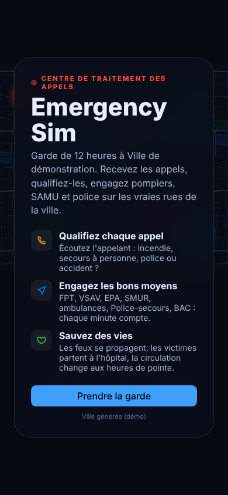
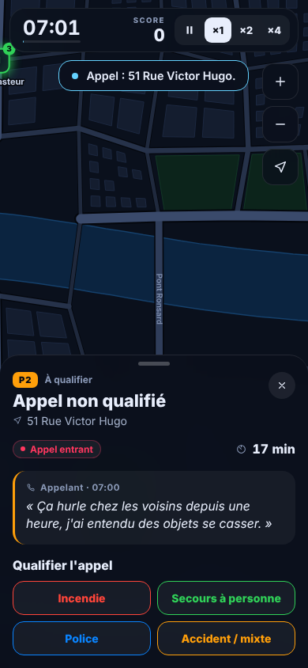
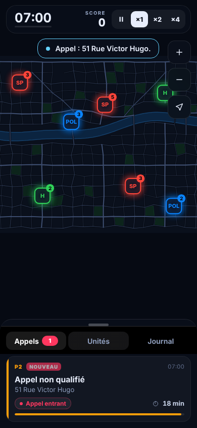
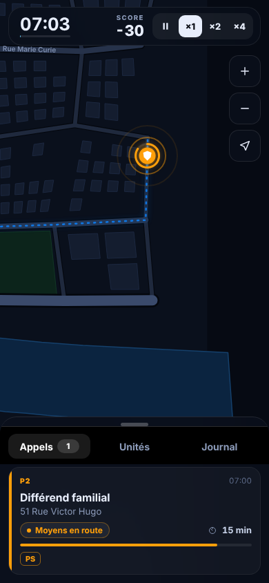
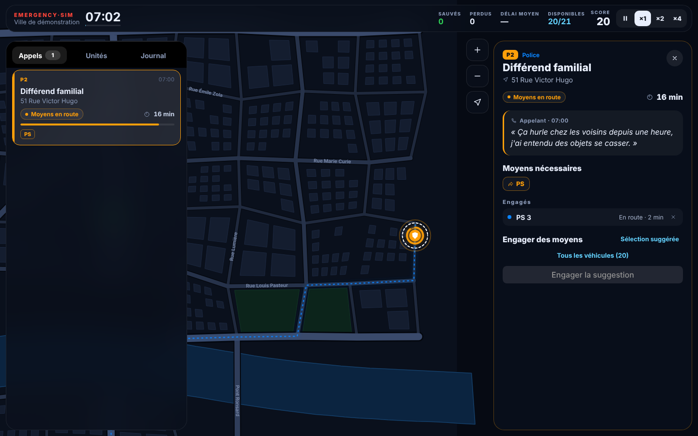

# Emergency Sim

Simulateur de centre de traitement des appels d'urgence. Vous recevez les appels, vous les qualifiez, puis vous engagez **pompiers, SAMU et police**. Les véhicules roulent sur les rues d'une vraie ville (OpenStreetMap). Construit avec [Exact](https://github.com/expo/exact) : une seule source pour le web, iOS, macOS, Android et Linux.

| Accueil | Appel entrant | Engagement | Intervention |
|---|---|---|---|
|  |  |  |  |



## Le jeu

- **Garde de 12 h** (07:00 → 19:00), vitesse ×1 / ×2 / ×4 et pause. Le volume d'appels augmente aux heures de pointe, la circulation aussi.
- **Appels réalistes** : l'appelant décrit la situation (« Mon mari ne respire plus ! »), vous la **qualifiez** :
  - incendie ;
  - secours à personne ;
  - police ;
  - accident / mixte.

  Une erreur coûte des points.
- **13 types d'interventions** : feu de poubelles, feu de véhicule, feu d'appartement, malaise, arrêt cardio-respiratoire, détresse respiratoire, chute de personne âgée, cambriolage, rixe, vol à l'arraché, différend familial, accident, accident grave avec victime incarcérée.
- **7 types de véhicules** :
  - pompiers : FPT, VSAV, EPA ;
  - SAMU : SMUR, ambulance ;
  - police : Police-secours, BAC.

  Ils sont répartis dans les vraies casernes, hôpitaux et commissariats.
- **Routage réel** : plus court chemin (Dijkstra) sur le graphe routier, avec la circulation, l'ETA en direct et l'itinéraire tracé sur la carte.
- **Interventions complètes** : arrivée sur les lieux → traitement → transport de la victime vers l'hôpital le plus proche (lits limités) → retour en caserne. Un feu non traité **se propage** et demande des renforts. Une victime secourue trop tard est perdue.
- **Bilan de garde** : score, victimes sauvées/perdues, délai moyen, justesse des qualifications, coût.

## Tester sur iPhone (sans compte Apple)

Le jeu tourne dans **Safari**. Aucune app à installer, aucun compte Apple.

**Option A, sans ordinateur (GitHub Pages)**
1. Sur GitHub : *Settings → Pages → Build and deployment → Deploy from a branch*. Choisissez la branche `claude/beautiful-fermi-drf3im` et le dossier `/docs`, puis *Save*.
2. Une à deux minutes plus tard, ouvrez `https://<votre-compte>.github.io/emergencyxsim/` dans Safari sur l'iPhone.
3. Partager → **Sur l'écran d'accueil** : le jeu s'ouvre en plein écran comme une app.

Sur un dépôt privé, GitHub Pages demande un forfait payant. Sinon, utilisez l'option B ou C.

**Option B, depuis votre ordinateur (même Wi-Fi)**
```sh
git clone https://github.com/expo/exact ../exact
bun ../exact/scripts/exact.mjs setup        # une seule fois (quelques minutes)
bun exact.mjs web --lan                      # affiche une URL http://192.168.x.x:8765/
```
Ouvrez cette URL dans Safari sur l'iPhone. Chaque modification du code recharge le jeu.

**Option C, hébergeur statique gratuit** : `bun run build`, puis glissez le dossier `dist/` sur Netlify Drop ou Cloudflare Pages.

## Votre ville (OpenStreetMap)

La carte livrée est une **ville de démonstration** générée (`tools/gen-demo-city.ts`). Pour jouer sur toute votre commune, avec ses rues, bâtiments, cours d'eau, casernes, hôpitaux et commissariats réels :

```sh
bun tools/bake-osm.ts "Annecy"                    # nom exact de la commune dans OSM
bun tools/bake-osm.ts "Saint-Denis" --insee 93066 # si plusieurs communes portent ce nom
tools/build-pages.sh                              # pour mettre à jour la version GitHub Pages
```

Le script interroge l'API Overpass (`overpass-api.de`) et écrit `data/city.json`. S'il manque un type de service dans la commune, une base fictive est ajoutée. Données © contributeurs OpenStreetMap (ODbL).

## Développer

| Commande | Effet |
|---|---|
| `bun exact.mjs web` | serveur de dev, rechargement à chaque sauvegarde |
| `bun exact.mjs test web` | tests de bout en bout (`app.test.contract`) |
| `bun test tools/` | tests du moteur (routage, interventions, garde complète) |
| `bun exact.mjs verify` | build + tests + contrôles (largeurs, accessibilité, grand texte) |
| `bun exact.mjs agent web --size 390x844 "tap start" "clock +30000" "screenshot shot.png"` | piloter le jeu et faire une capture |
| `tools/build-pages.sh` | reconstruit `docs/` pour GitHub Pages |

### Architecture

| Fichier | Rôle |
|---|---|
| `app.contract` | Toute l'interface en Contract, le langage d'interface d'Exact : barre de garde, file d'appels, fiche d'appel, flotte, journal, notifications, accueil, bilan. |
| `app.ts` | Module de données d'Exact : il répond aux requêtes de l'interface et dessine les canvas. |
| `sim/` | Moteur pur et déterministe (même graine = même garde) : `world.ts`, `catalog.ts`, `routing.ts`, `city.ts`, `rng.ts`. |
| `render/map.ts` | Carte vectorielle sur deux canvas Exact (fond statique + couche animée), gestes (glisser, pincer, molette). |
| `data/city.json` | La ville : graphe routier, bâtiments, eau, parcs, bases. |
| `tools/` | Générateur de ville démo, extracteur OSM, build GitHub Pages, tests du moteur. |
